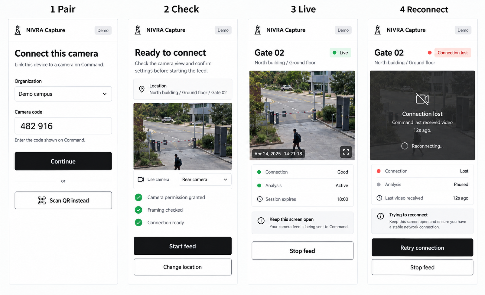
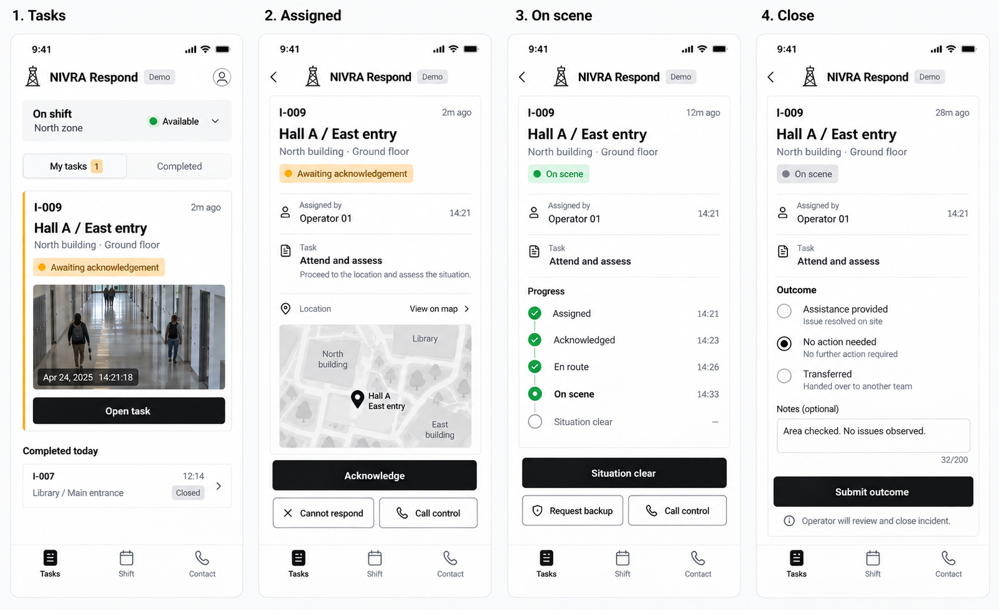
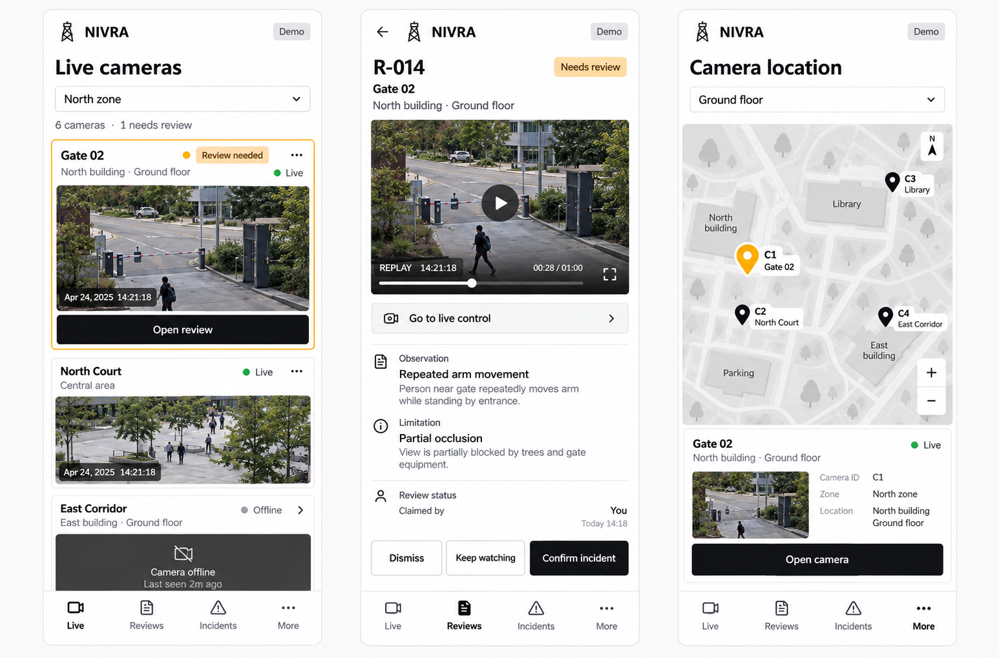
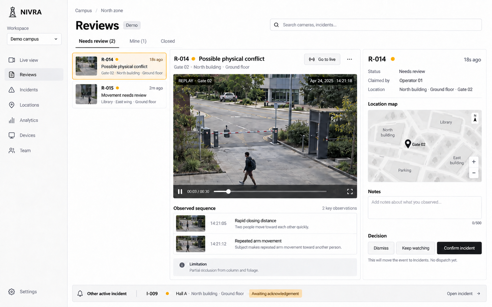
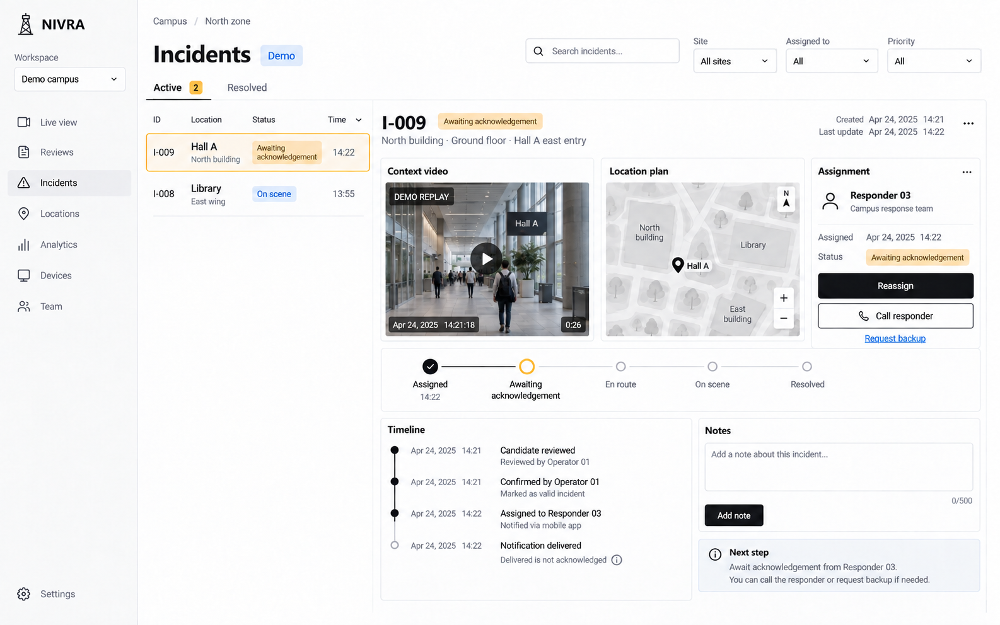
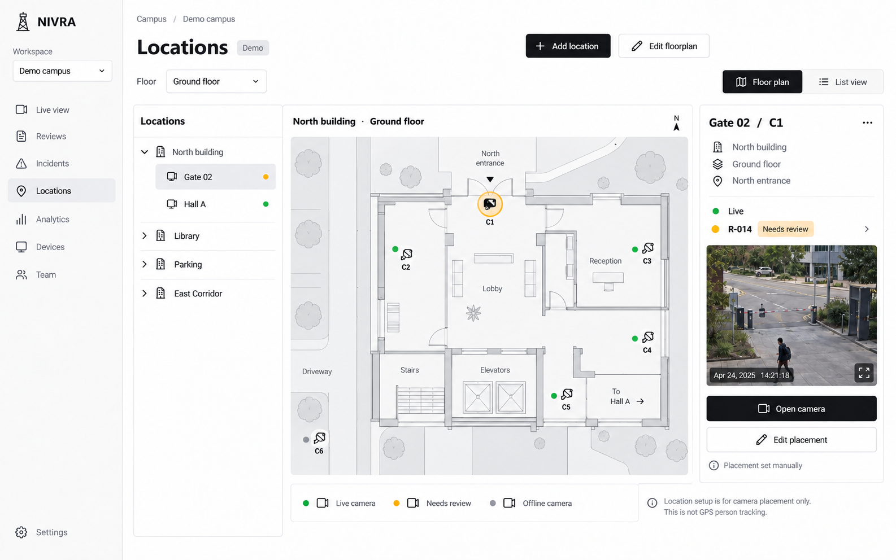
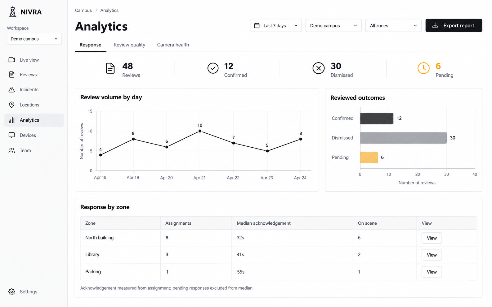
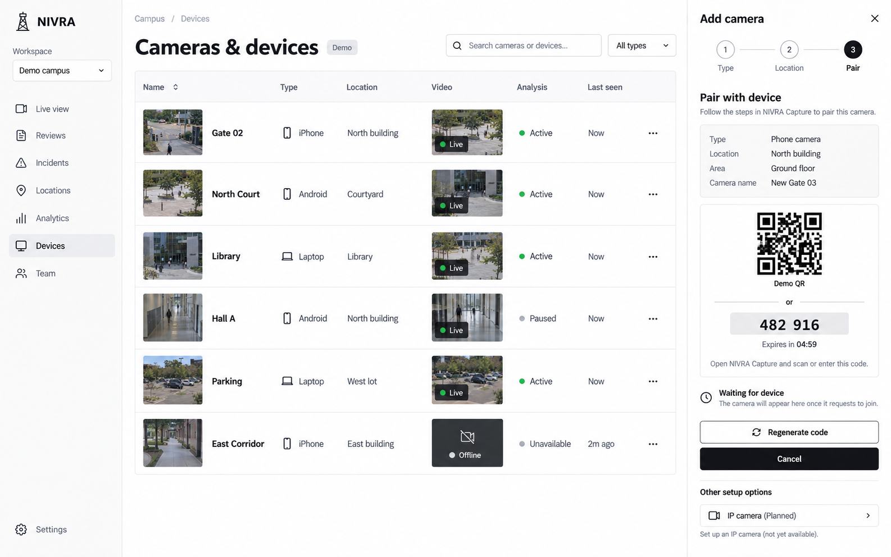
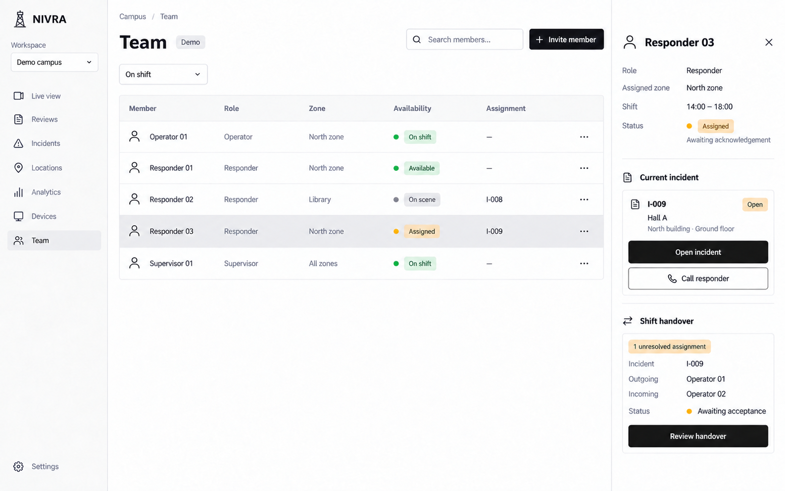
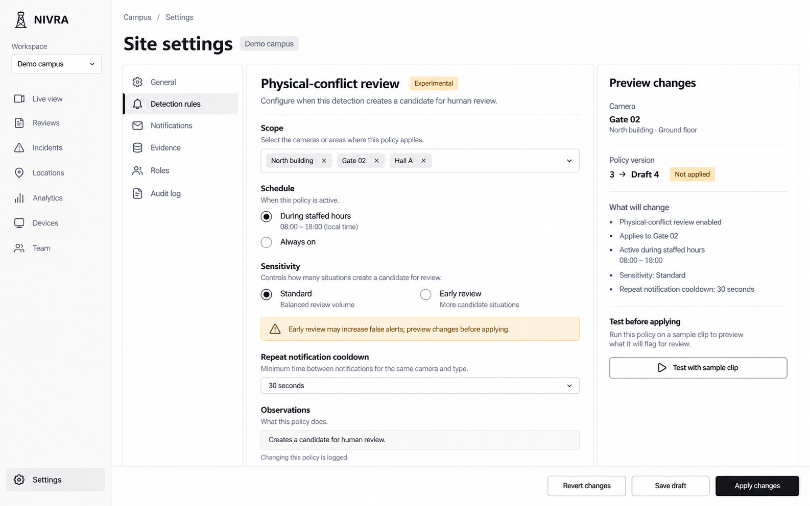

# NIVRA — extended UI screen set

18 screen/state concepts in 10 generated images. Built-in imagegen; selected reference: 00-selected-reference.png. Same predominantly white/black shadcn-style system. All footage, locations, charts, names and codes are illustrative demo content.

These are raster design concepts, not working software or editable component files. The selected desktop composition is preserved as the source; this extension does not reopen the three-direction gate.

## Phone Capture — pair, check, live, reconnect

## Phone Respond — tasks, assigned, on scene, outcome

## Phone Command — cameras, review, location

## Desktop Reviews

## Desktop Incidents

## Desktop Locations

## Desktop Analytics

## Desktop Devices and pairing

## Desktop Team and handover

## Desktop Settings and detection rules

## Review and handoff

All outputs were visually inspected in the imagegen results. Reviewed for legibility, fit, primary actions, source versus analysis status, mobile role separation and progression. Reviews was corrected to label replay and remove audio control; Incidents was corrected to show acknowledgement pending and use Hall A footage; Team was corrected for location and non-error On scene status. Analytics sample counts reconcile: daily volumes total 48 and outcomes total 48.

Remaining concept-stage limits: generated timestamps, tiny icons, sample map geometry and camera IDs across separate boards are illustrative and require normalization in implementation. Capture's paired-code example and desktop's new-camera example represent different sessions; QR is a nonfunctional placeholder. Permission/approval steps, authentication screens, all alternate Settings/Analytics tabs, and every empty/error state are specified at product-plan level but are not all drawn in this set. No real device pairing, browser interaction, accessibility conformance, model accuracy or backend behavior is verified by these images.

The selected screenshot's small tower icon is carried as a visual reference, not established as a new official logo master. Use the canonical project brand asset during implementation.

Prompt source: PROMPTS.md; targeted repair prompts: REPAIR-PROMPTS.md. No code, accounts, deployment or production configuration was changed.

